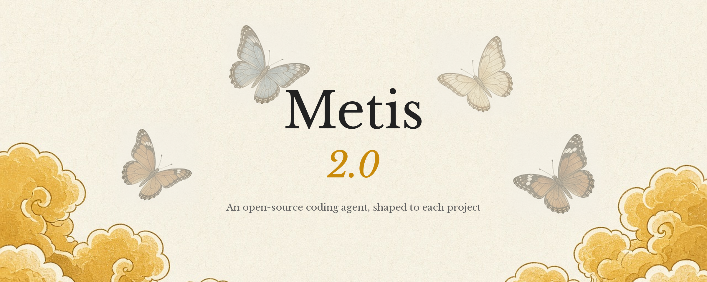
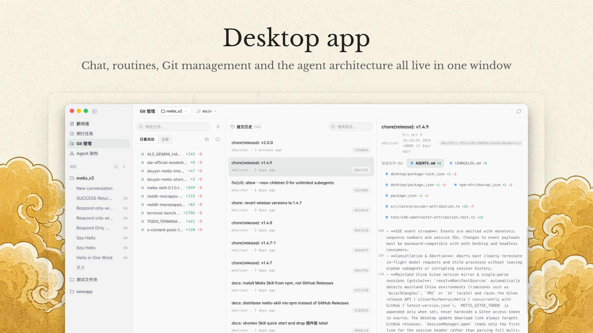
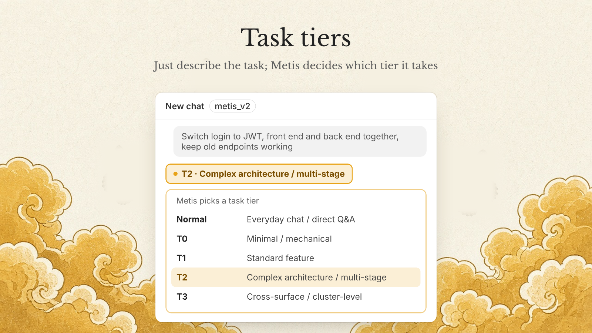
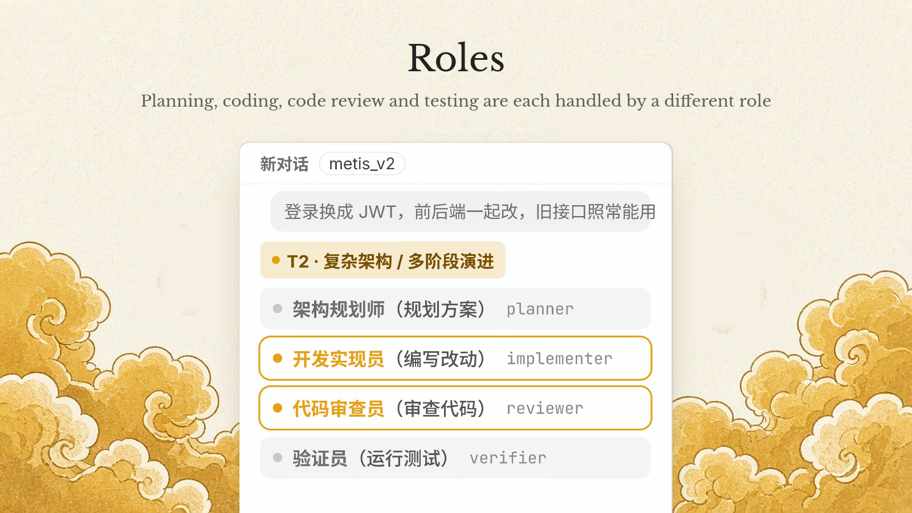
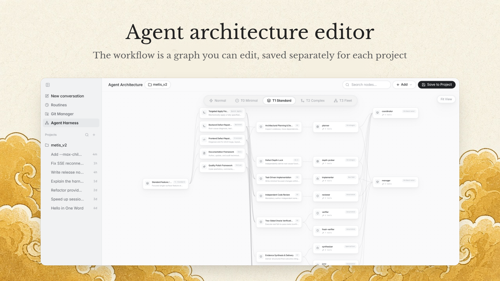
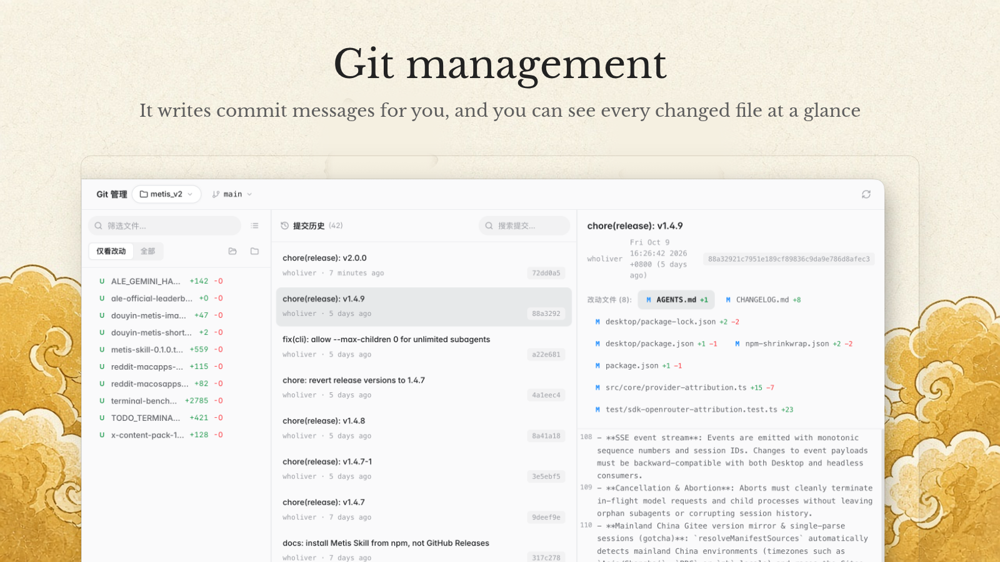
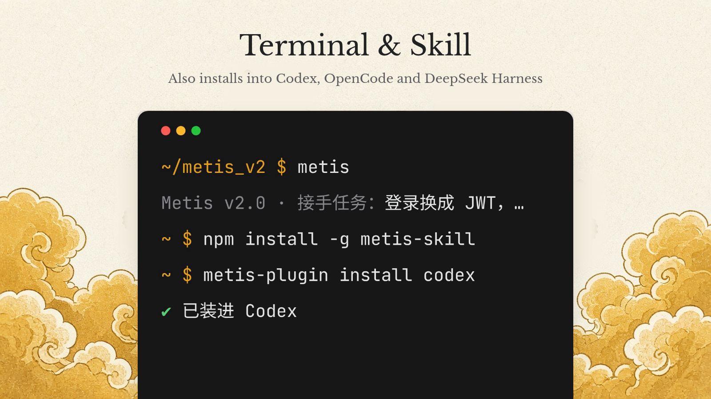

<p align="center">
  
</p>

<p align="center">
  <a href="README.zh-CN.md">简体中文</a> · <strong>English</strong>
</p>

<p align="center">
  Metis is an open-source coding agent that runs as a desktop app, in the terminal, or as a Skill, and every project can shape its own agent architecture.
</p>

<p align="center">
  <a href="https://www.typescriptlang.org/"></a>
  <a href="https://www.npmjs.com/package/@wholiver_hu/metis"></a>
  <a href="https://github.com/Wholiver/metis/releases/latest"></a>
  <a href="https://nodejs.org/"></a>
  <a href="#license"></a>
  <a href="https://siliconflow.cn"></a>
</p>

<p align="center"></p>

**Desktop (recommended):** download the installer from [GitHub Releases](https://github.com/Wholiver/metis/releases/latest): `.dmg` for macOS, `.exe` for Windows. The runtime is bundled, so you don't need Node.js.

**Terminal** (requires [Node.js 22.19.0 or newer](https://nodejs.org/)):

```bash
npm install -g @wholiver_hu/metis
```

**Skill:**

```bash
npm install -g metis-skill
metis-plugin install codex
```

For OpenCode or DeepSeek Harness, replace `codex` with `opencode` or `deepseek`. See the [Quickstart](docs/quickstart.md) for details.

## Desktop app



Chat, routines, Git and your agent architecture, all in one window.

## Task tiers



Just describe the task. Metis picks one of five tiers on its own, from quick questions to work that spans multiple interfaces.

## Roles



Planning, coding, code review and testing are each handled by a different role.

## Agent architecture editor



The workflow is a graph you can edit. Each project keeps its own copy in `.metis/harness.json`.

## Git



Metis drafts your commit messages, and you can see every changed file at a glance.

## Terminal and Skill



Prefer the terminal? Use it there. You can also install it into Codex, OpenCode and DeepSeek Harness.

<p align="center"></p>

| Logo | Partner | Link |
| :---: | :--- | :--- |
|  | **SiliconFlow (硅基流动)** — China's leading independent ecosystem token supply platform, providing Metis with efficient and flexible model inference. | [siliconflow.cn](https://siliconflow.cn) |

<p align="center"></p>

<p align="center">
  <br />
  <strong>Metis Community (QQ): 801193315</strong>
</p>

Found a bug or have an idea? Open an [issue](https://github.com/Wholiver/metis/issues) or start a [discussion](https://github.com/Wholiver/metis/discussions).

<p align="center"></p>

Every guide is listed in the [documentation index](docs/index.md). Start with the [Quickstart](docs/quickstart.md).

<p align="center"></p>

PRs are welcome. See [CONTRIBUTING.md](CONTRIBUTING.md) for development and testing.

Metis builds on [pi](https://github.com/earendil-works/pi) by Mario Zechner.

<p align="center"></p>

[MIT](LICENSE)

This project supports the [LINUX DO](https://linux.do) community.
