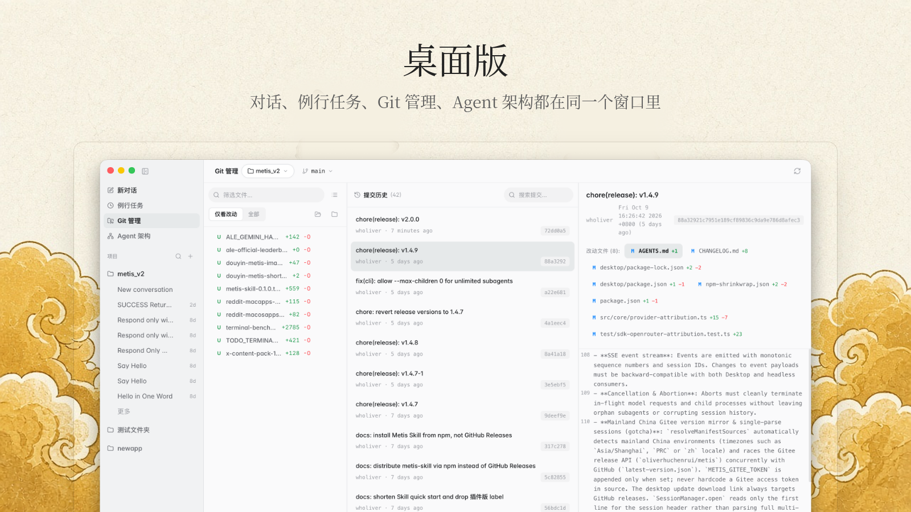
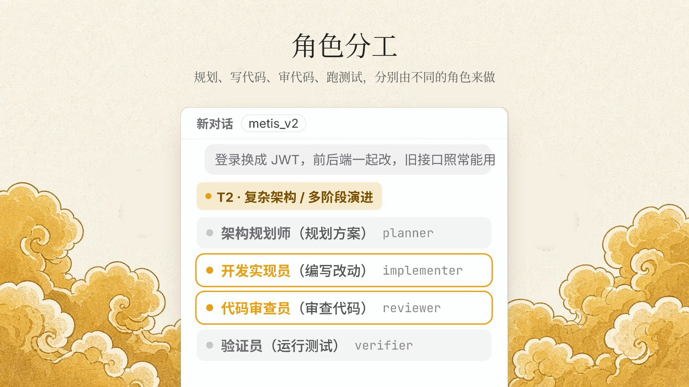
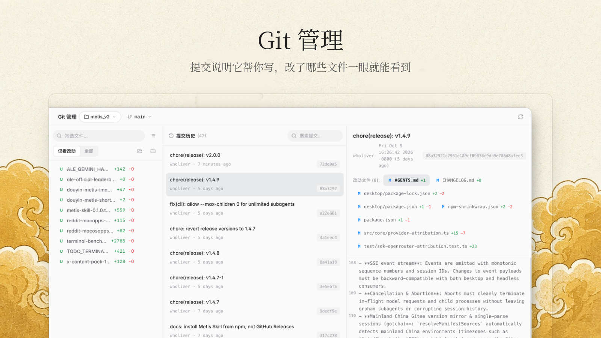
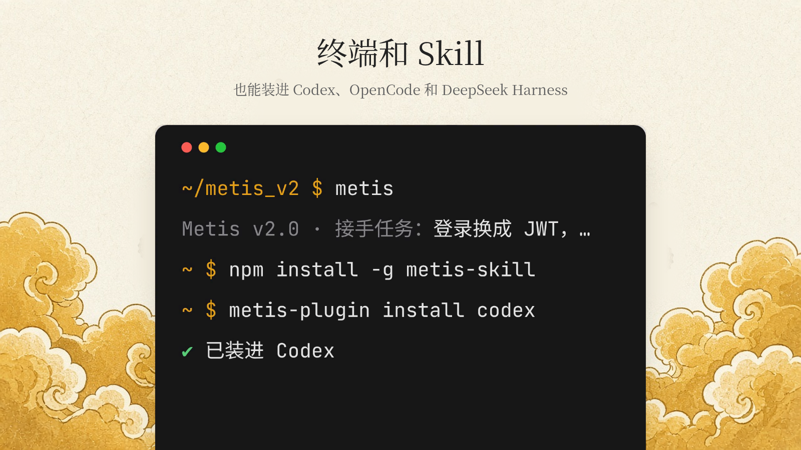

<p align="center">
  
</p>

<p align="center">
  <strong>简体中文</strong> · <a href="README.md">English</a>
</p>

<p align="center">
  Metis 是一个开源编程 Agent，有桌面版、终端版和 Skill 版，每个项目都能按自己的需要定制 Agent 架构。
</p>

<p align="center">
  <a href="https://www.typescriptlang.org/"></a>
  <a href="https://www.npmjs.com/package/@wholiver_hu/metis"></a>
  <a href="https://github.com/Wholiver/metis/releases/latest"></a>
  <a href="https://nodejs.org/"></a>
  <a href="#license"></a>
  <a href="https://siliconflow.cn"></a>
</p>

## 桌面版



对话、例行任务、Git 管理、Agent 架构都在同一个窗口里。

## 任务档位


你只管说任务，它自己判断走哪一档，从日常问答到跨界面协同分五档。

## 角色分工



规划、写代码、审代码、跑测试，分别由不同的角色来做。

## Agent 架构编辑


干活的流程是一张可以改的图，每个项目单独存一套，保存在 `.metis/harness.json`。

## Git 管理



提交说明它帮你写，改了哪些文件一眼就能看到。

## 终端和 Skill



不想开桌面版就在终端里用，也能装进 Codex、OpenCode 和 DeepSeek Harness。

## 快速开始

**桌面版（推荐）**：到 [GitHub Releases](https://github.com/Wholiver/metis/releases/latest) 下载安装包，macOS 选 `.dmg`，Windows 选 `.exe`。桌面版自带运行环境，不用另装 Node.js。

**终端版**（需要 [Node.js 22.19.0 或更新版本](https://nodejs.org/)）：

```bash
npm install -g @wholiver_hu/metis
```

**Skill 版**：

```bash
npm install -g metis-skill
metis-plugin install codex
```

想装进 OpenCode 或 DeepSeek Harness，把最后的 `codex` 换成 `opencode` 或 `deepseek`。更多说明见 [Quickstart](docs/quickstart.md)。

## 合作伙伴

| 商标 | 合作方 | 链接 |
| :---: | :--- | :--- |
|  | **SiliconFlow (硅基流动)** — China's leading independent ecosystem token supply platform, providing Metis with efficient and flexible model inference. | [siliconflow.cn](https://siliconflow.cn) |

## 交流群

<p align="center">
  <br />
  <strong>Metis 交流群（QQ）801193315</strong>
</p>

遇到问题或有新想法，也可以到 [Issues](https://github.com/Wholiver/metis/issues) 或 [Discussions](https://github.com/Wholiver/metis/discussions) 留言。

## 文档

所有使用说明都在 [文档目录](docs/index.md)，从 [Quickstart](docs/quickstart.md) 开始看就行。

## 参与贡献

欢迎提 PR，开发和测试方式见 [CONTRIBUTING.md](CONTRIBUTING.md)。

Metis 基于 Mario Zechner 的 [pi](https://github.com/earendil-works/pi) 开发，感谢原作者。

## License

[MIT](LICENSE)

本项目认可 [LINUX DO](https://linux.do) 社区。
